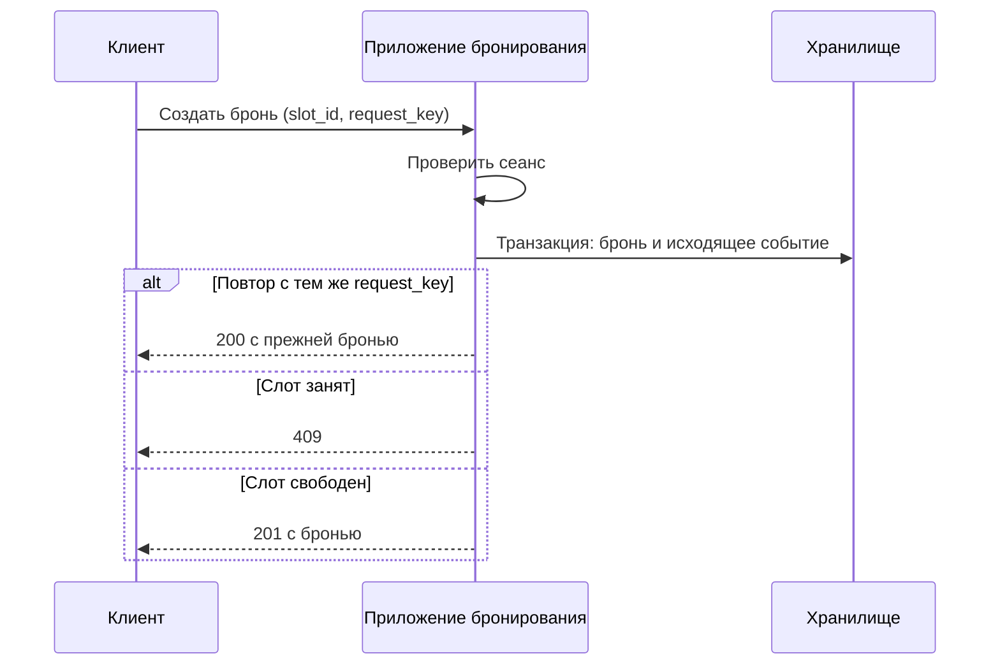

# API бронирования переговорных

> Учебный синхронный контракт. Машинной схемы нет; операция, коды ошибок и идемпотентность показывают смысл, а не готовую спецификацию.

## Владение и потребители

Владелец контракта — модуль бронирования. Потребители: веб-интерфейс сотрудника и служба отчётности по загрузке переговорных, работающая только на чтение. Личность сотрудника подтверждает корпоративная система входа; сервер берёт идентификатор сотрудника из проверенного сеанса, а не из тела запроса.

## Семантика

Операция одна — создать бронь слота. Тело запроса: `slot_id` и `request_key`; сотрудник определяется сеансом. Бронь и исходящее событие `booking.created.v1` записываются в одной транзакции; ответ не ожидает публикации события.

| Ответ | Когда возникает |
| --- | --- |
| `201` с бронью | Слот свободен, бронь создана |
| `409` | Слот занят; при конкурентных запросах бронь получает один запрос, остальные — конфликт |
| `401`, `403` | Сеанс отсутствует или сотруднику запрещено бронировать |
| `404` | Слот не найден |
| `200` с прежней бронью | Повтор с тем же `request_key` после потери ответа |

## Совместимость

Новые необязательные поля ответа не должны ломать действующего потребителя. Изменение обязательных полей, кодов ошибок или смысла операции требует новой версии пути и переходного периода. Markdown описывает смысл операции и не дублирует машинную схему целиком; в настоящем продукте здесь нужна ссылка на первоисточник. [OpenAPI](https://spec.openapis.org/oas/latest.html) — один из возможных форматов, не обязательный выбор платформы.

## Проверка

Проверить: при конкурентных запросах на один слот бронь создаётся ровно в одном; повтор с прежним `request_key` возвращает ту же бронь без новой записи; токены и персональные сведения не попадают в журналы запросов. Результатов пока нет; контракт остаётся черновиком.

Связи: [HLD](../hld/README.md), [данные](../data/README.md), [событие](../events/booking-created.md).
